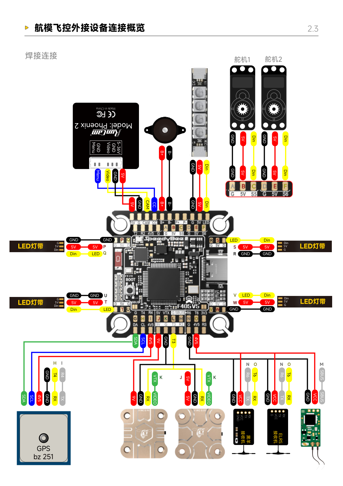

# Artemis — Technical Reference

Updated: 20 October 2026.

This document records existing hardware, identification evidence, manuals, wiring references and bench procedures. Purchase decisions and deliveries belong in the [Weekly Plan](weekly-plan.md). A component being present does not mean that it has passed testing.

## Existing hardware

| Item | Identification | Evidence and remaining work |
| --- | --- | --- |
| Electronic speed controller (ESC) | AIKON Electronics **AK32 35A**, labelled **2–6S**; individual ESC | Label reported on 7 October. Confirm that all installed units match and read their firmware. |
| Motor | Labelled **4006 / 620KV / 4S** | Brand and full part number unconfirmed. Speed control has been reported for the tested setup. |
| Power Distribution Board (PDB) | Existing power-distribution and signal-routing board | **Tarot TL6X002 is a candidate identity**, not a confirmed part number. Record its markings, connections and ratings. |
| Flight controller | **SpeedyBee F405 V5** | Identity confirmed over USB; Betaflight 4.5.2, QUADX and DShot600 recorded. USB sensor readback and a configuration/resource backup are available. |
| ESP32 experiment board | **CrowPanel 2.13-inch ESP32-S3 e-paper display** | Ownership confirmed; physical revision, recovery backup and SDR firmware compatibility remain unverified. |
| SDR receiver | **Nooelec NESDR SMArt v5** | Exact product confirmed; USB identification and recording tests have not been performed. |

The battery has been dispatched, but its specification and receipt are not yet confirmed. It is therefore tracked under deliveries rather than verified inventory. No ELRS transmitter, RF module or receiver is currently owned; recommended radio equipment is listed in the Weekly Plan.

## ESC — AIKON AK32 35A

The reported label is **AIKON Electronics / AK32 / 35A / 2–6S**. The matching manufacturer listing describes an individual ESC, distinct from the similarly named four-in-one products.

| Field | Manufacturer specification or remaining gap |
| --- | --- |
| Input | 2–6S LiPo |
| Continuous / burst current | 35 A / 45 A; captured specification does not establish burst duration or test conditions |
| Dimensions / weight including wires | 18 × 30 mm / 12 g; specification values, not measurements of our unit |
| Listed firmware target | `Aikon_AK32_35A_Multi`; installed target/version require readback |
| Firmware and signalling | BLHeli_32, DShot commands and telemetry listed; record the actual successful test configuration |
| BEC and complete pinout | Not established in the captured specification; identify control-wire functions on the actual unit |

References:

- [AIKON manufacturer listing](https://aikon-electronics.com/index.php?id=12), checked in the project records on 7 October 2026. A separate hardware datasheet PDF and complete pin diagram have not been located.
- [BLHeli_32 firmware manual](https://github.com/bitdump/BLHeli/blob/master/BLHeli_32%20ARM/BLHeli_32%20manual%20ARM%20Rev32.x.pdf). This covers protocols, settings and startup tones; it is not an AIKON hardware datasheet.

## Motor — 4006 620KV

The installed motor was reported as **4006, KV620, 4S**. Do not infer the brand from those markings alone. Tarot **TL68P02** is a comparison reference, not a confirmed identity for our motors.

- [Tarot 4006/620KV TL68P02 comparison listing](https://www.flyingtech.co.uk/product/tarot-4006-620kv-4s-multirotor-brushless-disc-motor-tl68p02/). Its combination and performance figures are not measurements of our aircraft.
- [Tarot frame assembly reference](https://www.mhm-modellbau.de/downloads/680PRO.pdf). The document is headed *IRON MAN 680*; the downloaded filename alone does not establish the revision of our frame.

**Progress reported on 10 October:** motor speed can be controlled. The exact motor/ESC pair, output channel, protocol, command range, supply conditions and stopping result still need to be recorded. This does not establish that all six motors have passed testing or that the aircraft is ready to fly.

## Power Distribution Board

The old aircraft has a board carrying power distribution and signal routing. **TL6X002 remains a tentative identification.** Distinguish this separate board from the frame's PCB centre plate and the individual ESCs.

The [TL6X002 comparison reference](https://www.flyingtech.co.uk/product/tarot-hexacopter-power-distribution-board-signal-hub-tl6x002/) helps identify the category of board. It is not a verified map of our wiring.

Record:

- Board markings and clear views of both sides and every connector.
- Main input/output polarity and continuity with power disconnected.
- Each signal path from the flight controller through the PDB to its ESC.
- Ratings and the function of any auxiliary outputs, supported by documentation or suitable measurements.

Current rating and regulated-output voltages are not yet established. Do not infer a 5 V or 12 V output from a connector shape, wire colour or the candidate product name.

## Flight controller — SpeedyBee F405 V5

The board reports **SPEEDYBEEF405V5** over USB. The recorded firmware is **Betaflight 4.5.2**, configured as **QUADX**, with **DShot600** selected. USB communication, sensor readback and a configuration/resource backup have been obtained.

ArduCopter and a six-motor output arrangement remain proposed development steps. The existing four-motor configuration is not evidence of a completed six-output setup. A configuration backup is also distinct from a full firmware image.

References:

- [SpeedyBee F405 V5 manufacturer information](https://www.speedybee.com/speedybee-f405-v5-55a-stack/).
- [Manufacturer manual portal](https://docs.speedybee.cn/en/fpv/fc-flight-controller/f405v5-flight-control/f405_v5-_ox32-55a_user-manual.html).
- [Manufacturer manual, Chinese PDF](https://spcdn.speedybee.cn/cdn/196552442110808064.pdf).

### Peripheral pin map

The following is the existing manufacturer pin-map reference, reproduced unchanged from the saved manual extract. Its original labels are in Chinese; board labels such as `GND`, `T6`, `R6`, `S5` and `S6` remain visible. It shows manufacturer example peripherals, not the list of devices installed on Artemis or a validated six-motor configuration.



For our aircraft, a complete wiring record must additionally identify each actual ESC, motor position, signal output, ground connection and direction. Verify signal routing through the old PDB before treating it as a transparent extension of a flight-controller output.

## Betaflight six-motor configuration (proposed)

Added 20 October 2026. This section is a **desk proposal** for running the hexacopter on Betaflight. It was derived from the Betaflight source for release 2026.6.2 and the official `SPEEDYBEEF405V5` board definition. **None of it has been tested on our board.** Back up with `diff all` before applying any command, and remove all propellers for every motor test.

### Why S5/S6 need extra work

The board definition assigns M1–M4 as motor outputs with DMA already allocated. S5 and S6 are defined as **servo outputs with no DMA**, so they cannot send DShot until they are reassigned. Electrically they are ordinary 3.3 V MCU outputs like M1–M4; once configured, Betaflight treats motors 5 and 6 the same as motors 1–4.

| Output | MCU pin | Timer | DMA in board definition | DMA options (Betaflight index) |
| --- | --- | --- | --- | --- |
| M1 | PB1 | TIM3 CH4 | Assigned (DMA1) | — |
| M2 | PB0 | TIM3 CH3 | Assigned (DMA1) | — |
| M3 | PB10 | TIM2 CH3 | Assigned (DMA1) | — |
| M4 | PB11 | TIM2 CH4 | Assigned (DMA1) | — |
| S5 | PC9 | TIM8 CH4 | **None** | 0 = DMA2 Stream 7 (only option) |
| S6 | PC8 | TIM8 CH3 | **None** | 0 = DMA2 Stream 2; 1 = DMA2 Stream 4 |

Notes:

- The board definition places ADC1 on **DMA2 Stream 4**, so S6 should use option 0. Option 1 would collide with the ADC.
- PC8/PC9 can also map to TIM3, but TIM3 already drives M1/M2. Keep S5/S6 on TIM8, which is the board default.
- Other peripherals that can use DMA2 Streams 2 or 7: gyro SPI1 receive, UART1 transmit/receive and UART6 transmit/receive. Check the actual allocation with `dma show`.
- S5 = PC9 and S6 = PC8 follow from the board definition's SERVO1/SERVO2 order. Confirm against `resource show` and the pin map above before wiring.

### Proposed CLI commands

```
resource SERVO 1 NONE
resource SERVO 2 NONE
resource MOTOR 5 C09
resource MOTOR 6 C08
dma pin C09 0
dma pin C08 0
mixer HEX6X
save
```

After the reboot, run `resource show`, `timer show`, `dma show` and `status`. Expected: MOTOR 5 = C09 and MOTOR 6 = C08 on TIM8; DMA2 Stream 7 → MOTOR 5, DMA2 Stream 2 → MOTOR 6, DMA2 Stream 4 → ADC; no shared streams; no errors in `status`.

### HEX6X motor positions and directions

From the Betaflight `mixerHex6X` table. The front of the aircraft lies **between two arms**; directions are viewed from above with `yaw_motors_reversed = OFF`.

| Betaflight motor | Position | Default direction | Output if wired directly |
| --- | --- | --- | --- |
| 1 | Rear right | Counter-clockwise | M1 |
| 2 | Front right | Counter-clockwise | M2 |
| 3 | Rear left | Clockwise | M3 |
| 4 | Front left | Clockwise | M4 |
| 5 | Right (middle) | Clockwise | S5 |
| 6 | Left (middle) | Counter-clockwise | S6 |

Directions alternate around the frame. If the propellers are mounted the opposite way, set `yaw_motors_reversed = ON` and reverse **all six**, never a subset.

Three ways to match outputs to positions. Use only one, so the final mapping stays traceable:

1. Wire each ESC signal to the output in the table. No further remapping is needed.
2. Keep the existing wiring and use the Configurator **Motors → Reorder motors** tool. It stores the result in `motor_output_reordering`, which `diff all` captures.
3. Swap pins with `resource MOTOR n <pin>` (free both pins with `NONE` first). The DMA setting follows the pin; re-check `dma show` afterwards.

Correct reversed motors in BLHeli_32 Suite, or with the Configurator motor-direction tool if available, rather than swapping motor phase wires by trial.

### If S5/S6 still do not work

Work through these in order and record each result:

1. **Hardware:** confirm the wire is on the S5/S6 pad, check continuity through the PDB, confirm a common signal ground, and look for a DShot waveform at the pad. Move the motor 5 ESC to M1 to check whether the fault follows the ESC/motor or the output.
2. **DMA conflict:** if a UART transmit holds DMA2 Stream 7, release it with `dma UART_TX 1 NONE` or `dma UART_TX 6 NONE`. If DMA2 Stream 2 is taken, move the other user (for example `dma SPI_SDI 1 0`), or use `dma pin C08 1` together with `dma ADC 1 0`. Re-check `dma show` after every change, because moving one peripheral can create a new collision.
3. **Bitbang DShot:** `dma pin C09 NONE`, `dma pin C08 NONE`, `set dshot_bitbang = ON`, `save`. This does not depend on per-pin DMA and also supports bidirectional DShot.
4. **Other pads:** for example the LED strip pad PA8 (TIM1 CH1, has DMA): `resource LED_STRIP 1 NONE`, then `resource MOTOR 5 A08`. Check `timer show` and `dma show`.
5. **Fallback protocol:** DShot300, or an analogue protocol such as Oneshot125 (no DMA needed, but no bidirectional DShot or RPM filter; analogue protocols need ESC range calibration with propellers removed).
6. **Platform change:** ArduPilot, or a flight controller with native 6–8 motor outputs. ArduPilot support for this exact board has not been checked.

Enable bidirectional DShot (`set dshot_bidir = ON`) only after all six motors run on plain DShot, then re-check `dma show` and the RPM readout.

### Other changes for a large hexacopter

- **ESCs:** match firmware and settings across all six. Set `motor_poles` to the counted magnet number (22 is common for 4006 motors, but count ours). Bidirectional DShot needs BLHeli_32 32.7 or later.
- **Tuning:** Betaflight defaults suit 5-inch quadcopters. Start with much lower P and D, low rates and Angle mode. Lower `dyn_notch_min_hz` and `rpm_filter_min_hz` only after inspecting a Blackbox noise spectrum. Raise `dshot_idle_value` only if motors do not run smoothly at idle. A Blackbox rate of 1–2 kHz is sufficient.
- **Power and safety:** calibrate the voltage reading. Set the current meter to none if no sensor is wired. Test failsafe with propellers removed by switching off the transmitter.
- **Firmware:** Betaflight 2025.12 and later add Altitude Hold and GPS Position Hold, but these need a GPS (and preferably a magnetometer), which we do not own.

### Open issues

| Issue | Status | Next action |
| --- | --- | --- |
| Motors 5/6 unassigned in the current Betaflight 4.5.2 setup | Recorded fact | Apply and verify the proposed commands above |
| S5/S6 DShot output | **Untested**; DMA collision possible | Check `dma show`, then the fallback list |
| Mapping of the six ESCs/arms to outputs | Not recorded | Number the arms, trace each signal through the PDB, choose one mapping method |
| Motor directions and propeller orientation | Not recorded | Compare each motor with the HEX6X table, props removed |
| ESC firmware version and settings on all six units | Not read | Read through BLHeli_32 passthrough; record version and `motor_poles` |
| Common signal ground for every ESC | Not verified | Continuity check from each ESC signal ground to FC ground |
| Radio link | No receiver owned | Configure CRSF on UART6 after the receiver arrives |
| Tuning for the 680-class frame | Not started | First hover in Angle mode with conservative PIDs; log Blackbox |

Sources: [Betaflight `SPEEDYBEEF405V5` board definition](https://github.com/betaflight/config/blob/master/configs/SPBE/SPEEDYBEEF405V5/config.h), [Betaflight 2026.6.2 STM32 DMA map](https://github.com/betaflight/betaflight/blob/2026.6.2/src/platform/STM32/dma_reqmap_mcu.c), [Betaflight 2026.6.2 STM32F4 timer table](https://github.com/betaflight/betaflight/blob/2026.6.2/src/platform/STM32/timer_stm32f4xx.c), [Betaflight 2026.6.2 mixer tables](https://github.com/betaflight/betaflight/blob/2026.6.2/src/main/flight/mixer_init.c), [Betaflight 2025.12 release notes](https://betaflight.com/docs/wiki/release/Betaflight-2025-12-Release-Notes).

## Bench procedures

These procedures support repeatable tests; they are not completed test results. Remove all propellers for motor bench tests, secure the hardware, and disconnect power before changing wiring.

### ESC signal and motor checks

1. **Identify the inputs.** Distinguish main power, the three motor-phase wires and thin control wires. Establish Signal, reference GND, any BEC output and any required optocoupler supply from the actual device documentation. Do not assign an unidentified third wire to 5 V. Resolve the power path before combining a tester supply, ESC BECs or a USB-powered flight controller.
2. **Observe the unloaded signal.** Measure the control input relative to signal ground. Record high/low levels, pulse widths and repetition interval. Keep a logic analyser within its input-voltage rating. Conventional PWM often uses roughly 1000–2000 microsecond pulses, with device-dependent stopping points and refresh rates. DShot is a digital protocol: a multimeter's average voltage does not verify a valid DShot command.
3. **Establish a compatible reference.** Use a known-compatible tester/receiver or a flight-controller output already verified without motor power. Prepare the stop command and use a supply appropriate for the identified ESC and test. Run a brief low-command test with the motor secured and propeller removed. Do not perform full-throttle power-up calibration on an unidentified ESC.
4. **Trace the output.** Compare the waveform at the F405 output, PDB entry and ESC connector. Save settings before changing protocols, and verify the new output with motor power isolated. A single-ESC test does not require migrating the entire flight-control firmware.
5. **Isolate faults.** Check voltage at the ESC, startup voltage drop, signal, reference ground, protocol and stop endpoint. Disconnect power before exchanging one component in a known-compatible combination. Record whether the fault follows the ESC or motor. Unloaded rotation does not demonstrate loaded reliability, thrust or flight readiness.

Before using an earth-referenced oscilloscope, establish the relationship between signal ground, computer USB, supply and protective earth. Never clip its ordinary ground lead to a motor phase or positive supply, or defeat protective earth. Verify an unclear setup before measuring. Check that the power source can handle startup transients and braking energy rather than repeatedly increasing a current limit. Record current as unmeasured if no suitable instrument is available.

References: [ArduPilot ESC signal protocols](https://ardupilot.org/copter/docs/common-brushless-escs.html) and [Hobbywing tester compatibility](https://support.hobbywingdirect.com/hc/en-us/articles/19157002618131-Using-a-Servo-Tester-to-operate-your-Electronic-Speed-Control). These describe methods and compatibility considerations, not the condition of our equipment.

### Connection checks

| Connection | Check | What success establishes |
| --- | --- | --- |
| USB → F405 | Read board/firmware identity, attitude and Ports/Receiver settings; save evidence | Computer-to-flight-controller communication |
| Phone → F405 Bluetooth | Under the current Betaflight setup, read settings through SpeedyBee App and record failures | Configuration access; it does not establish a flight radio link or Bluetooth support after a firmware migration |
| Radio → receiver → F405 | Identify exact models, protocol, supply and UART; with motor power isolated, check channels and response to receiver loss | Control data and loss detection at the flight controller; a receiver LED alone is insufficient |

For a serial ELRS receiver using CRSF, verify receiver **TX → flight-controller RX**, receiver **RX ← flight-controller TX**, ground and supply against the exact board diagrams. UART6 is a proposed connection and must be checked against current port assignments. USB power does not imply every 5 V pad is powered; a USB-powered 4V5 output must still suit the receiver. See the [ExpressLRS wiring guide](https://www.expresslrs.org/quick-start/receivers/wiring-up/).

## Radio experiments

The CrowPanel ESP32-S3 internal-radio SDR investigation is separate from bringing up a supported ELRS control link. Source review and offline modelling have been carried out, but capture-firmware adaptation, physical capture and ELRS interoperability have not been demonstrated on our board.

The owned NESDR SMArt v5 provides a separate receive-only SDR experiment. Its manufacturer's specified tuning range includes 868/915 MHz, but not 2.4 GHz; it cannot substitute for a 2.4 GHz ELRS transmitter. See the [NESDR SMArt v5 datasheet](https://www.nooelec.com/store/downloads/dl/file/id/111/product/246/nesdr_smart_rtl_sdr_v5_datasheet_revision_1.pdf).

The immediate preparation is to identify the physical boards, establish recoverable firmware/software setups and verify capture/recording. Known signal sources are needed before claiming ELRS reception. Finding a waveform, recovering bytes, maintaining a bidirectional radio link and controlling the aircraft are separate milestones.

## Recording results

Use one row per identified unit and test:

| Date / evidence | Unit ID and exact label | Wiring / channel | Firmware / protocol | Supply | Command / test | Observed result |
| --- | --- | --- | --- | --- | --- | --- |
| To record | To record | To record | To record | To record | To record | To record |

Keep a test plan separate from its result, and identify the source of each claim: label, manufacturer specification, direct measurement or reported observation. Add received hardware here after checking its identity; update ordering and delivery status in the Weekly Plan.
